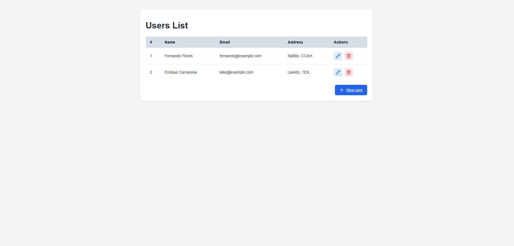
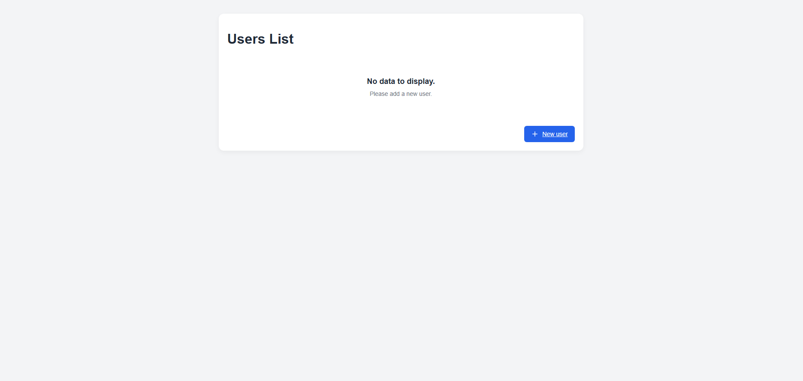
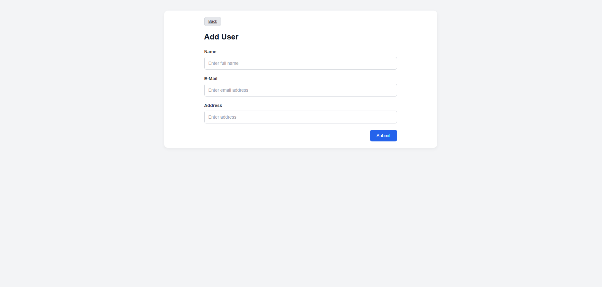
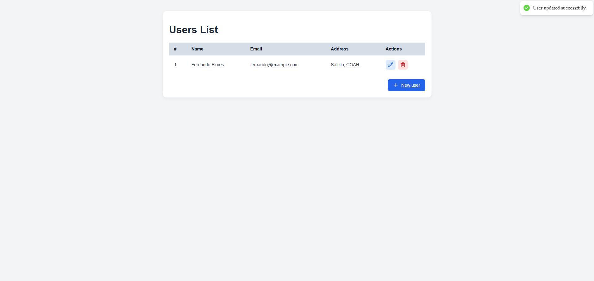

# MERN CRUD Application


A full stack application to manage users (create, list, edit, and delete), built with the **MERN** stack: MongoDB, Express, React, and Node.js.

> **What is the MERN stack?** It is a set of four technologies for building complete web applications: **MongoDB** (database), **Express** and **Node.js** (server and API), and **React** (user interface). It is widely used in modern web development, from learning projects to production apps. It works well because everything is written in **JavaScript**, so the same language is used on the frontend, the backend, and the database (which stores data in JSON-like format), making it easier to learn, maintain, and share code across layers.

## Features

- Full CRUD for users (name, email, and address).
- Server-side validation to prevent duplicate emails (returns `409 Conflict`).
- Conditional rendering: when there are no records, a message prompts the user to add one.
- Toast notifications when creating, updating, and deleting users.
- Client-side routing with React Router (list, add, and edit views).
- UI icons powered by Lucide.

## Screenshots

### Table with records

User list with edit and delete actions on each row.



### No records (conditional rendering)

View displayed when the database has no users.



### Add new user

Form to create a new user.



### Update user (toast)

Notification shown after a user is successfully updated.



## Tech Stack

**Frontend**

- React 19
- Vite
- React Router DOM
- Axios
- React Hot Toast
- Lucide React

**Backend**

- Node.js
- Express 5
- Mongoose
- MongoDB
- dotenv, cors, body-parser
- Nodemon (development)

## Project Structure

```
mern-crud-application/
├── client/                  # React app (Vite)
│   └── src/
│       ├── add-user/        # Form to create users
│       ├── get-user/        # User list
│       ├── update-user/     # Form to edit users
│       ├── App.jsx          # Route definitions
│       └── main.jsx         # Entry point and Toaster
├── server/                  # REST API (Express)
│   ├── controller/          # Logic for each endpoint
│   ├── model/               # Mongoose schema
│   ├── routes/              # Route definitions
│   └── index.js             # Server and MongoDB connection
├── screenshots/             # Images used in this README
└── README.md
```

## Prerequisites

- [Node.js](https://nodejs.org/) (LTS version recommended)
- [MongoDB](https://www.mongodb.com/) running locally, or a MongoDB Atlas connection string

## Getting Started

### 1. Clone the repository

```bash
git clone https://github.com/floreslog/mern-crud-application.git
cd mern-crud-application
```

### 2. Set up the server

```bash
cd server
npm install
```

Create a `.env` file inside `server/` based on `.env.example`:

```env
PORT=8000
MONGO_URL="mongodb://localhost:27017/mern-crud"
```

> **Important:** the client sends its requests to `http://localhost:8000`, so the server must run on port `8000`.

Start the server:

```bash
npm run dev     # with nodemon (development)
# or
npm start       # with node
```

### 3. Set up the client

In a separate terminal:

```bash
cd client
npm install
npm run dev
```

The app will be available at `http://localhost:5173` (Vite's default port).

## API

Base URL: `http://localhost:8000/api`

| Method | Endpoint            | Description            |
| ------ | ------------------- | ---------------------- |
| POST   | `/user`             | Create a new user      |
| GET    | `/users`            | Get all users          |
| GET    | `/user/:id`         | Get a user by ID       |
| PUT    | `/update/user/:id`  | Update a user by ID    |
| DELETE | `/delete/user/:id`  | Delete a user by ID    |

### User model

```json
{
  "name": "string",
  "email": "string",
  "address": "string"
}
```

All three fields are required.

## Available Scripts

**Server (`/server`)**

| Command       | Description                  |
| ------------- | ---------------------------- |
| `npm start`   | Start the server with Node   |
| `npm run dev` | Start the server with Nodemon |

**Client (`/client`)**

| Command           | Description                   |
| ----------------- | ----------------------------- |
| `npm run dev`     | Start the development server  |
| `npm run build`   | Create a production build     |
| `npm run preview` | Preview the production build  |
| `npm run lint`    | Run ESLint                    |

## Note

This project was built solely for learning purposes.
